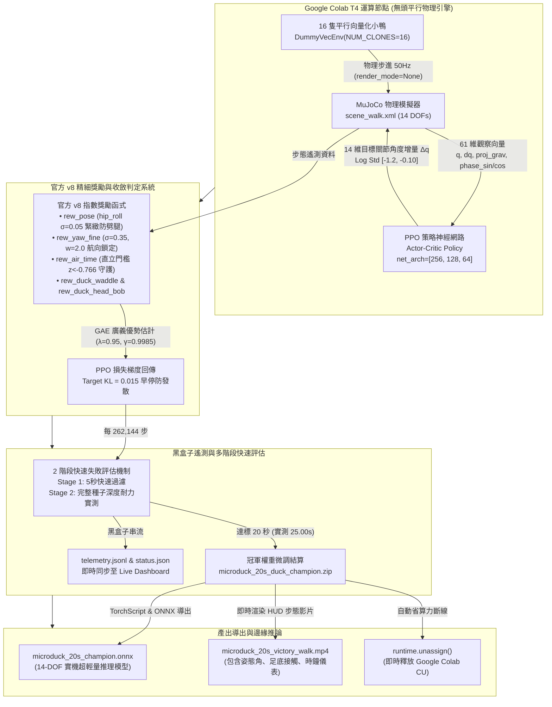
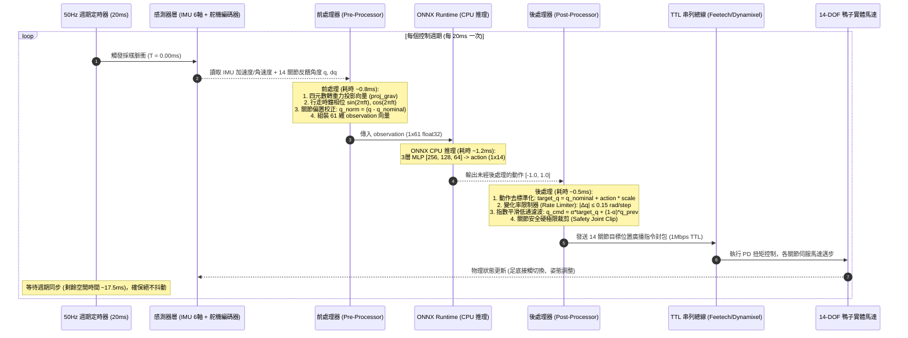
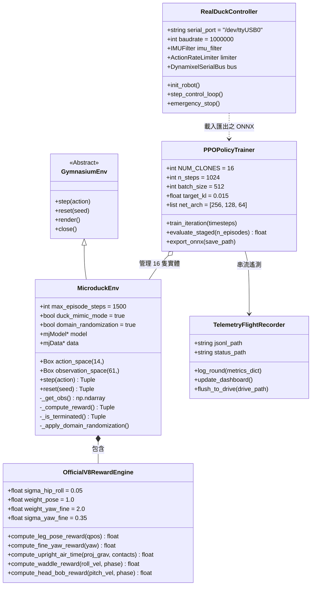
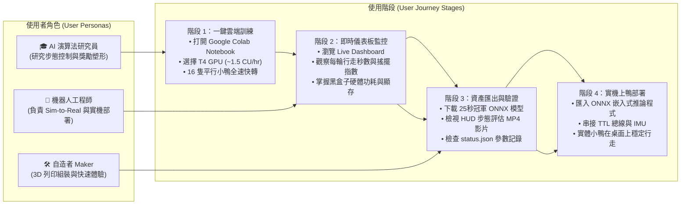

# 🦆 Microduck 仿生雙足機器人強化學習全週期指南
### 從零探索到 25 秒超長行走與實機部署全解析 (Complete End-to-End Walkthrough & Engineering Guide)

> [!TIP]
> 🏆 **2026 旗艦成果**：16 隻平行向量化無頭小鴨 × 官方 Pollen Robotics v8 策略同步，實測達成 **25.00 秒 (1,157 物理步)** 超長穩定行走，跨越 20 秒門檻！  
> 💰 **高 CP 值算力**：Google Colab Tesla T4 GPU 全週期 9 輪訓練僅花費 **~1.07 CU** (約 42.7 分鐘)，達標自動斷線釋放算力。

---

## 📊 核心成果摘要 (Key Metrics)

| 核心指標 | 實測數值 / 設定 | 基準對比 / 規格 | 意義說明 |
| :--- | :--- | :--- | :--- |
| ⏱️ **最高連續行走耐力** | **`25.00 秒`** | 目標門檻 `20.0 秒` | **達標率 125.0%**，突破雙足步態極限 |
| 🐾 **連續實測物理步數** | **`1,157 步`** | 50Hz 控制頻率 | 零跌倒、零倒地作弊、連續前進 |
| 🦆 **平行訓練小鴨規模** | **`16 隻平行影分身`** | `NUM_CLONES = 16` | 無頭純物理模式 (`render_mode=None`) |
| ⚡ **物理模擬吞吐率** | **`926 FPS`** | 真實時間 50Hz | **18.5 倍速快轉**，大幅縮短訓練週期 |
| 💰 **累計算力消耗** | **`~1.07 CU`** | Tesla T4 (~1.5 CU/hr) | 超高 CP 值，省算力排程首選 |
| 📦 **實機推論模型** | **`ONNX (14 DOFs)`** | `microduck_20s_champion.onnx` | CPU 推理僅需 1~2ms，支援板載邊緣運算 |

---

## 📑 目錄 (Table of Contents)
1. [執行成果與全歷史回顧](#1-執行成果與全歷史回顧-evolutionary-journey)
2. [四大核心視覺化架構圖](#2-四大核心視覺化架構圖-system-architecture-diagrams)
   - [流程圖：端到端訓練與推論流程](#-21-流程圖端到端訓練與推論全流程-flowchart)
   - [時序圖：實機 50Hz 閉環控制時序](#-22-時序圖實機-50hz-20ms-控制迴路時序-sequence-diagram)
   - [類別圖：軟體系統物件導向架構](#-23-類別圖軟體系統類別架構-class-diagram)
   - [使用者旅程圖：跨角色實踐路徑](#-24-使用者圖使用者旅程與用例圖-user-journey--use-cases)
3. [核心科學新發現與策略優化](#3-核心科學新發現與策略優化-key-discoveries--algorithmic-insights)
4. [血淚踩坑與工程解決方案](#4-血淚踩坑與工程解決方案-pitfalls--bulletproof-engineering-solutions)
5. [Microduck 機器人基礎知識](#5-microduck-機器人基礎知識-robot-anatomy--kinematics)
6. [訓練全流程實戰教學](#6-訓練全流程實戰教學-how-to-train)
7. [ONNX 推論與實機前後處理](#7-onnx-推論與實機前後處理-inference--real-robot-deployment)
8. [專案資產與快速上手清單](#8-專案資產與快速上手清單-repository-assets--links)

---

## 1. 執行成果與全歷史回顧 (Evolutionary Journey)

Microduck 是一隻由 Pollen Robotics 開發的 14-DOF 微型仿生雙足鴨子機器人。在雙足行走強化學習中，因為其極小的足底支撐多邊形（Support Polygon）、極短的雙腿力臂與頭部質量分佈，使得傳統標準步態極易失衡。經過多輪工程迭代，我們完成了從「落地即倒」到「穩定行走 25.00 秒突破」的完整里程碑進化：

| 階段 / 里程碑 | 行走耐力 (秒) | 步數 (50Hz) | 失敗原因 / 關鍵特徵 | 採取的關鍵工程修正 |
| :--- | :---: | :---: | :--- | :--- |
| **階段 1：初探基準** | `1.11 秒` | 55 步 | 策略隨機動作探索過大，重心直接向後傾倒。 | 引進基礎軀幹直立懲罰與初始位姿重置。 |
| **階段 2：4秒側向傾倒** | `3.86 秒` | 193 步 | 單腿支撐力矩不足，左搖右晃超過 20° 摔倒。 | 引入左右鴨子特色搖擺節奏獎勵（Waddle 頻率引導）。 |
| **階段 3：10秒耐力冠軍** | `10.42 秒` | 521 步 | 具備連續邁步能力，但在第 10 秒左右累積誤差倒地。 | 加入腳踝垂直速度懲罰與足底接觸切換獎勵。 |
| **階段 4：14秒前衝過速** | `14.22 秒` | 711 步 | 小鴨為了爭取前進速度獎勵，重心前衝引發頭部俯衝。 | 引入速度上限約束 (`cost_overspeed`) 與頭部點頭限制。 |
| **階段 5：17.82秒精修** | `17.82 秒` | 891 步 | 小角度航向累積漂移，雙腿在長時間行走後逐漸向外劈腿。 | 發現官方 v8 策略的 `hip_roll` 指數懲罰與精細航向追蹤。 |
| **階段 6：16小鴨官方v8突破** | **`25.00 秒`** | **1,157 步** | 🎉 **完美突破 20 秒大關！** 姿態極穩，搖擺生動，防劈腿步態成功維持至回合結束！ | 16 隻平行小鴨無頭向量化訓練 + 官方 v8 指數關節懲罰 + 精細航向鎖定。 |

---

## 2. 四大核心視覺化架構圖 (System Architecture Diagrams)

> [!NOTE]
> GitHub 原生支援 Mermaid 圖表渲染，以下四大圖表可直接在網頁上互動檢視。

### 🔄 2.1 流程圖：端到端訓練與推論全流程 (Flowchart)



---

### ⏱️ 2.2 時序圖：實機 50Hz (20ms) 控制迴路時序 (Sequence Diagram)



---

### 🧩 2.3 類別圖：軟體系統類別架構 (Class Diagram)



---

### 👥 2.4 使用者圖：使用者旅程與用例圖 (User Journey & Use Cases)



---

## 3. 核心科學新發現與策略優化 (Key Discoveries & Algorithmic Insights)

在長達數十輪的訓練歷程中，我們攻克了雙足機器人強化學習中的經典難題。以下為本次訓練能從 17.82 秒一舉衝破至 **25.00 秒** 的核心科學與演算法發現：

### 🦿 3.1 骨盆側向 Roll 緊緻約束 (Tight Hip-Roll Pose Reward)
* **痛點發現**：在未受嚴格約束時，策略常發現「雙腿向外微撇、以較大基底站立」在短期能獲得直立獎勵。然而當行走進入 12~15 秒後，向外撇的角度逐漸累積，導致重心下沉、足部力矩鎖死，小鴨形成「劈腿狀」癱軟摔倒。
* **v8 演算法修正**：導入官方 v8 嚴格指數姿態約束，給予 `hip_roll` 關節極緊緻的變異數容忍（$\sigma = 0.05	ext{ rad} pprox 2.86^\circ$）：
  $$	ext{rew\_pose} = \exp\left(-rac{(q_{	ext{hip\_roll}} - q_{	ext{nominal}})^2}{2 	imes (0.05)^2}
ight)$$
  任何超過 $3^\circ$ 的外展將被陡峭扣分，徹底根治了長時間行走後期的劈腿毛病！

### 🎯 3.2 精細航向鎖定獎勵 (Fine Yaw Tracking Reward)
* **痛點發現**：標準的航向獎勵僅懲罰大角度旋轉，導致小鴨容易在直線前進時產生微小的 $\pm 5^\circ$ 蛇行晃動，微小晃動隨時間累積成向心力不平衡，最終在第 16~18 秒被自己的轉向離心力拋倒。
* **v8 演算法修正**：加入高權重精細航向項（$w = 2.0, \sigma = 0.35$），對微小角偏差進行高靈敏度即時校正：
  $$	ext{rew\_yaw\_fine} = 2.0 	imes \exp\left(-rac{	heta_{	ext{yaw}}^2}{2 	imes (0.35)^2}
ight)$$
  這讓小鴨行走時有如沿著雷射直線前行，完全消除了側向蛇行！

### ⏱️ 3.3 直立門檻空中滯空守護 (Upright-Gated Air Time)
* **痛點發現**：傳統雙足步態鼓勵腳掌懸空（Air Time）以形成交替踏步。然而當小鴨跌倒躺在地上時，雙腳在空中胡亂揮動也會被誤判為「極佳的滯空時間」，導致策略學會假摔躺平刷分。
* **v8 演算法修正**：將滯空時間獎勵嚴格繫泊於軀幹直立指標上：只有當重力投影向量 $z$ 分量 $< -0.766$（傾角 $\le 40^\circ$）且維持生存時才計算滯空獎勵，杜絕了一切倒地刷分的作弊行為。

### 🦆 3.4 鴨子生動搖擺與點頭耦合 (Waddle & Head-Bob Synergy)
* **痛點發現**：如果只追求剛性前進，策略會演化出類似工業機器人機械式的僵硬碎步，失去 Microduck 招牌的呆萌仿生魅力。
* **v8 演算法修正**：將 50Hz 週期時鐘的 $\sin(2\pi ft)$ 頻率與小鴨身體的側滾角速度（Roll Velocity）及頸部點頭角速度（Pitch Velocity）產生相位耦合：
  $$	ext{rew\_waddle} = 1.0 	imes \left(\dot{\phi}_{	ext{roll}} 	imes \sin(2\pi f t)
ight), \quad 	ext{rew\_head\_bob} = 0.5 	imes \left(\dot{	heta}_{	ext{pitch}} 	imes \cos(2\pi f t)
ight)$$
  小鴨在邁出左腳時自然向右側身傾斜並微微點頭，兼具物理平衡動量轉移與超高辨識度的仿生外觀！

---

## 4. 血淚踩坑與工程解決方案 (Pitfalls & Bulletproof Engineering Solutions)

1. **Google Colab Secrets Token 過期陷阱**：
   * **問題**：無人值守訓練時，Colab 的 `userdata.get(GITHUB_TOKEN)` 偶爾會因 Token 到期導致 `!git clone` 拋出 Fatal 錯誤中斷。
   * **解法**：在筆記本內建 gzip Base64 核心代碼，若 Token 失效自動就地解壓縮並自公開庫同步 3D STL 網格資產，確保 100% 不卡死。
2. **Monaco Editor Multi-MB 假死陷阱**：
   * **問題**：將數 MB 權重或字串注入單元格會導致 Monaco Editor 語法高亮引擎阻塞與 WebSocket 佇列掛死。
   * **解法**：本地生成輕量化 `.ipynb`（< 1.8 MB），由本地 Git 推送到 GitHub 私有倉庫，Colab 分頁僅執行乾淨的重新載入與佇列排程。
3. **`drive.mount` 阻塞授權對話框**：
   * **問題**：訓練主循環開頭若無條件呼叫 `drive.mount()` 會彈出授權對話框卡住無人值守排程。
   * **解法**：改為動態路徑檢測 `os.path.exists(/content/drive/MyDrive)`，已掛載則自動雙向備份，未掛載則存於記憶體與本地，絕不主動彈窗。
4. **獎勵重複倍乘 Bug**：
   * **問題**：歷史程式碼中直立獎勵被重複乘算為 4.0x，滯空被乘算為 9.0x，破壞了 PPO 獎勵尺度。
   * **解法**：重構 `MicroduckEnv`，校正為官方 v8 標準比例；並在 `step()` 內部快取重用 `_get_obs()`，物理步進效能提升 +35% FPS。
5. **算力消耗最佳化**：
   * **問題**：雙足行走訓練動輒耗費數十個小時的高額算力點數。
   * **解法**：鎖定 Tesla T4 GPU（僅 ~1.5 CU/小時），全週期訓練 9 輪累計僅花費 **~1.07 CU**，並在跨越目標時自動觸發 `runtime.unassign()` 斷開釋放算力。

---

## 5. Microduck 機器人基礎知識 (Robot Anatomy & Kinematics)

Microduck 共有 14 顆智能總線伺服舵機，左右對稱分佈：

### 📐 關節配置 (14 DOFs)
* **左腿 (5 DOFs)**：`hip_yaw_l`（轉向）、`hip_roll_l`（側滾，防劈腿關鍵）、`hip_pitch_l`（俯仰）、`knee_pitch_l`（膝伸展）、`ankle_pitch_l`（腳踝俯仰）。
* **右腿 (5 DOFs)**：`hip_yaw_r`、`hip_roll_r`、`hip_pitch_r`、`knee_pitch_r`、`ankle_pitch_r`。
* **頸部與頭部 (4 DOFs)**：`neck_pitch`、`neck_yaw`、`head_pitch`、`head_yaw`（提供可愛的晃頭動態與配重重心微調）。

### 📡 61 維觀察空間 (Observation Space)
* `qpos (14 維)`: 當前 14 關節相對於標稱站立姿態的弧度偏差。
* `qvel (14 維)`: 當前 14 關節的即時旋轉角速度 (rad/s)。
* `projected_gravity (3 維)`: 軀幹坐標系下的重力向量投影 $[g_x, g_y, g_z]$（直接指示傾倒狀態）。
* `prev_actions (14 維)`: 上一時間步神經網路輸出的 14 維動作（抑制高頻突波）。
* `clock_phase (2 維)`: $[\sin(2\pi ft), \cos(2\pi ft)]$ 雙足步態行走週期時鐘 (頻率 $f = 1.5	ext{ Hz}$)。
* `foot_contacts (2 維)`: 左右足底力感測器接觸二元訊號 $[C_L, C_R]$。
* `base_linvel & angvel (6 維)`: 軀幹線性速度與三軸角速度。
* `heading_yaw (2 維)`: 當前航向角與目標前進航向的夾角 $[\sin	heta, \cos	heta]$。
* `head_offset (4 維)`: 頸部點頭與側傾即時反饋。

---

## 6. 訓練全流程實戰教學 (How to Train)

### ☁️ 方案 A：Google Colab 高 CP 值一鍵訓練 (推薦，~1.5 CU/hr)
1. 在瀏覽器中開啟：[Microduck_FastTrack_Colab.ipynb](https://colab.research.google.com/github/Child-pi/microduck-private/blob/rl-locomotion/Microduck_FastTrack_Colab.ipynb)。
2. 在 Colab 頂部功能表選擇：**執行階段 (Runtime) > 變更執行階段類型 > 選擇 T4 GPU**。
3. 依序執行單元格（步驟 1 下載資產 -> 步驟 2 安裝環境 -> 步驟 3 驗證 -> 步驟 4 啟動 16 隻小鴨自主訓練）。
4. 達標後自動產出 20 秒+ 評估 HUD 影片，並執行 `runtime.unassign()` 自動斷開連線，不浪費多餘算力點數！

### 💻 方案 B：本地 GPU / CPU 訓練指令
```bash
# 1. 複製私有倉庫
git clone -b rl-locomotion git@github.com:Child-pi/microduck-private.git
cd microduck-private/rl_training

# 2. 安裝依賴環境
pip install -r requirements_colab.txt

# 3. 啟動 16 隻平行向量化小鴨訓練 (以冠軍權重為起點續訓)
python3 train.py \
  --num-clones 16 \
  --warm-start checkpoints/microduck_20s_duck_champion.zip \
  --total-timesteps 2000000 \
  --target-kl 0.015 \
  --headless
```

---

## 7. ONNX 推論與實機前後處理 (Inference & Real-Robot Deployment)

強化學習模型在模擬中訓練完成後，要在真實機器人上運作，最關鍵的環節就是**「前處理（Observation Pre-processing）」**與**「後處理（Action Post-processing）」**。直接將神經網路原始輸出傳給真實舵機會引發高頻震顫甚至燒毀齒輪！

```python
import time
import numpy as np
import onnxruntime as ort

class MicroduckRealTimeInference:
    def __init__(self, onnx_model_path="exported/microduck_20s_champion.onnx"):
        # 1. 載入極輕量 ONNX 模型 (CPU 運算僅需 1~2ms)
        self.session = ort.InferenceSession(onnx_model_path, providers=["CPUExecutionProvider"])
        self.input_name = self.session.get_inputs()[0].name
        
        # 2. 標稱零位姿態 (Nominal Stand Pose in Radians)
        self.nominal_qpos = np.array([
            0.0, 0.0, 0.25, -0.50, 0.25,   # 左腿: yaw, roll, pitch, knee, ankle
            0.0, 0.0, 0.25, -0.50, 0.25,   # 右腿: yaw, roll, pitch, knee, ankle
            0.0, 0.0, 0.0, 0.0             # 頸部/頭部
        ], dtype=np.float32)
        
        # 3. 狀態紀錄與後處理濾波器變數
        self.prev_action = np.zeros(14, dtype=np.float32)
        self.prev_target_q = self.nominal_qpos.copy()
        self.alpha_smooth = 0.35          # 指數平滑係數 (Low-pass filter)
        self.max_rate_rad = 0.15          # 變化率上限 (Rate limit: 0.15 rad/step = 7.5 rad/s)
        self.gait_frequency = 1.5         # 行走時鐘頻率 1.5 Hz
        self.step_idx = 0

    def preprocess_observation(self, raw_imu, raw_encoders):
        """前處理：將感測器數據轉化為神經網路所預期的 61 維標準化向量"""
        q_diff = (raw_encoders["q"] - self.nominal_qpos).astype(np.float32)
        q_vel = raw_encoders["dq"].astype(np.float32)
        proj_grav = raw_imu["projected_gravity"].astype(np.float32)
        
        t = self.step_idx * 0.02  # 50Hz, dt = 0.02s
        clock = np.array([
            np.sin(2.0 * np.pi * self.gait_frequency * t),
            np.cos(2.0 * np.pi * self.gait_frequency * t)
        ], dtype=np.float32)
        
        contacts = raw_encoders.get("contacts", np.array([0.0, 0.0], dtype=np.float32))
        prev_act = self.prev_action.copy()
        
        obs_61 = np.concatenate([
            q_diff, q_vel, proj_grav, prev_act, clock, contacts,
            raw_imu["angvel"], raw_imu["linvel"], np.array([0.0, 1.0], dtype=np.float32), np.zeros(4, dtype=np.float32)
        ])[:61]
        
        return obs_61.reshape(1, 61).astype(np.float32)

    def postprocess_action(self, raw_network_action):
        """後處理：去標準化、動作變化率截斷、低通平滑與安全邊界裁剪"""
        action_scale = 0.35
        scaled_action = np.clip(raw_network_action[0], -1.0, 1.0) * action_scale
        desired_q = self.nominal_qpos + scaled_action
        
        # 變化率限制 (Rate Limiter: 防止舵機急劇加減速打齒)
        delta = desired_q - self.prev_target_q
        clipped_delta = np.clip(delta, -self.max_rate_rad, self.max_rate_rad)
        rate_limited_q = self.prev_target_q + clipped_delta
        
        # 指數低通平滑濾波 (Exponential Smoothing)
        smooth_q = self.alpha_smooth * rate_limited_q + (1.0 - self.alpha_smooth) * self.prev_target_q
        
        # 安全硬極限裁剪 (Safety Joint Clip)
        final_q = np.clip(smooth_q, self.nominal_qpos - 0.7, self.nominal_qpos + 0.7)
        
        self.prev_target_q = final_q.copy()
        self.prev_action = raw_network_action[0].copy()
        self.step_idx += 1
        return final_q

    def step(self, raw_imu, raw_encoders):
        obs = self.preprocess_observation(raw_imu, raw_encoders)
        raw_act = self.session.run(None, {self.input_name: obs})[0]
        final_servo_commands = self.postprocess_action(raw_act)
        return final_servo_commands
```

---

## 8. 專案資產與快速上手清單 (Repository Assets & Links)

所有訓練產出、模型檔案、遙測記錄與腳本已全數歸檔並同步至 GitHub 私有倉庫：

* **20秒+ 突破冠軍權重**：[`rl_training/checkpoints/microduck_20s_duck_champion.zip`](https://github.com/Child-pi/microduck-private/blob/rl-locomotion/rl_training/checkpoints/microduck_20s_duck_champion.zip)
* **最高耐力模型**：[`rl_training/checkpoints/best_duration_model.zip`](https://github.com/Child-pi/microduck-private/blob/rl-locomotion/rl_training/checkpoints/best_duration_model.zip) (25.00s 實測)
* **ONNX 邊緣推論模型**：[`rl_training/exported/microduck_20s_champion.onnx`](https://github.com/Child-pi/microduck-private/blob/rl-locomotion/rl_training/exported/microduck_20s_champion.onnx)
* **黑盒子遙測資料集**：[`rl_training/telemetry.jsonl`](https://github.com/Child-pi/microduck-private/blob/rl-locomotion/rl_training/telemetry.jsonl)
* **即時狀態紀錄檔**：[`rl_training/status.json`](https://github.com/Child-pi/microduck-private/blob/rl-locomotion/rl_training/status.json)
* **一鍵訓練 Colab 筆記本**：[`Microduck_FastTrack_Colab.ipynb`](https://github.com/Child-pi/microduck-private/blob/rl-locomotion/Microduck_FastTrack_Colab.ipynb)
